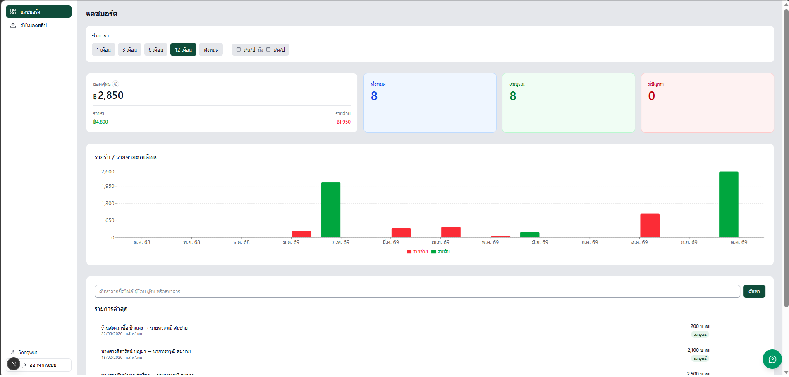
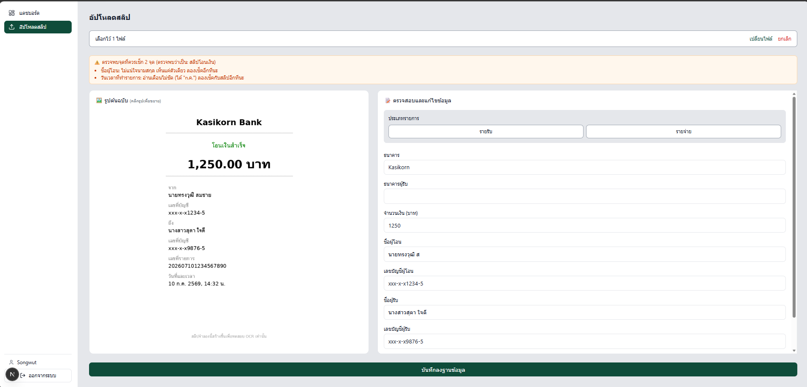
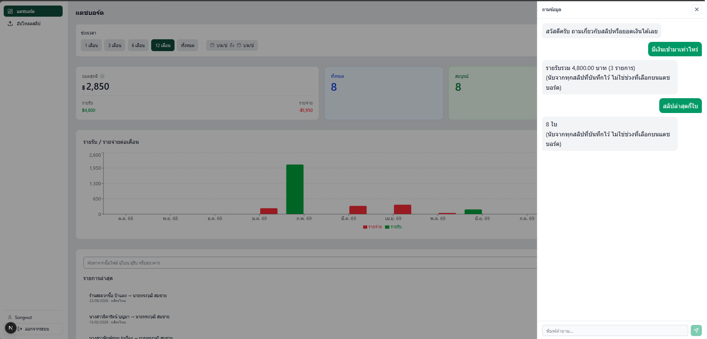
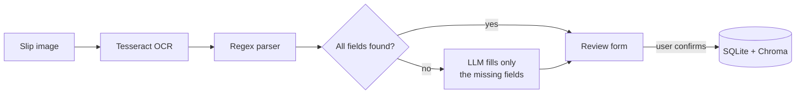
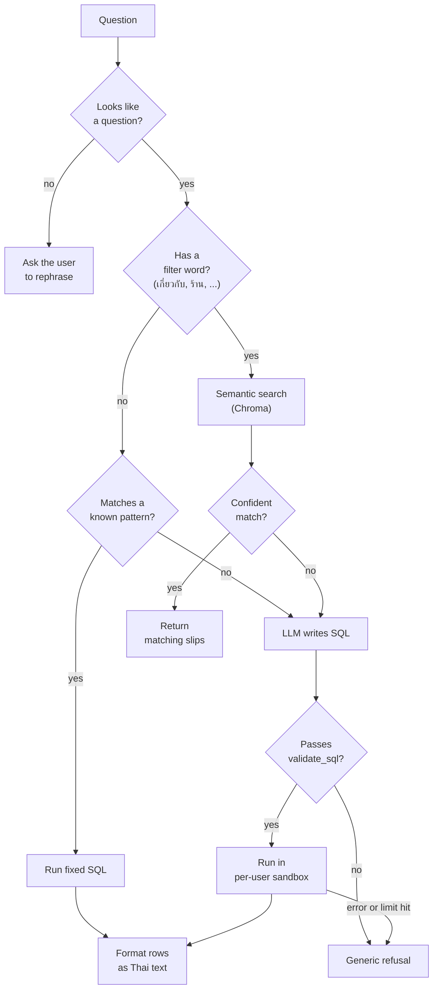

# VeriSlip

Read Thai bank transfer slips with OCR, review the result before saving,
then ask questions about your slips in Thai. Everything runs locally —
no slip data is sent to an outside service.



## What it does

- **Upload slips** — one file or a batch, with drag-and-drop.
- **Extract fields automatically** — Tesseract OCR (Thai + English) reads
  the slip, a rule-based parser pulls out the amount, date/time, names and
  account numbers, and a local LLM (qwen3:8b) fills in only the fields the
  parser could not find.
- **Review before saving** — each result opens in an editable form, and a
  banner lists the fields worth checking (for example, an empty name or an
  unreadable date).
- **Dashboard** — income and expense per month, net total, and recent slips
  with search, download and delete.
- **Ask in Thai** — for example, "เดือนไหนมีสลิปเยอะที่สุด"
  (Which month has the most slips?). Common questions use fixed SQL;
  other questions are turned into SQL by the LLM and run in a read-only,
  per-user sandbox.
- **Multi-user** — JWT login, and each user can only see their own slips.

## Screenshots

| Review before saving | Ask in Thai |
|---|---|
|  |  |

## Architecture

### Tech stack

| Layer | Tools |
|---|---|
| Frontend | Next.js 16, TypeScript, Tailwind CSS v4 |
| Backend | FastAPI (Python) |
| OCR | Tesseract (Thai + English) |
| LLM | qwen3:8b via Ollama (runs locally) |
| Storage | SQLite (slip data), Chroma (vector search) |
| Embeddings | intfloat/multilingual-e5-small |
| Auth | JWT (HS256), passwords hashed with bcrypt |

### Reading a slip



- The regex parser runs first because it is fast and predictable.
  The LLM is only asked about fields the parser could not find, and
  the app records which fields came from the LLM.
- Nothing is saved until the user checks the result. OCR can misread
  Thai text, and the LLM copies those mistakes, so a person has the
  final say.

### Answering a question (`/ask`)



- **Patterns first.** Common questions (totals, counts, highest /
  lowest, per month) run fixed SQL and answer almost instantly.
- **Filter words skip patterns.** A question like
  "มีสลิปกี่ใบที่เกี่ยวกับร้านกาแฟ" (How many slips are about coffee
  shops?) used to match the "how many" pattern and return the count of
  *all* slips. A confident wrong answer is worse than no answer, so
  questions with filter words go to semantic search instead.
- **Semantic search only answers when it is confident** — the closest
  match must be near enough, and results stop at the first big jump in
  distance. Otherwise the question falls through to the LLM.
- **LLM output is never trusted.** `validate_sql` requires a single
  `SELECT`, blocks write and schema keywords (`INSERT`, `DROP`,
  `ATTACH`, `PRAGMA`, ...), allows only the `slips` table, rejects a
  `main.` prefix, and adds `LIMIT 200` if missing.
- **Per-user sandbox.** The query runs on a read-only connection where
  `slips` is a temporary copy of the current user's rows only, so even
  subqueries cannot see other users' data. It is stopped after
  5 seconds, and any single value over 1 MB is rejected
  (see [Security](#security)).
- **Templates write the answer.** The LLM never writes the final
  answer, so every number comes straight from the database. Refusals
  and errors show a generic message; the real reason is logged on the
  server.

### Project structure

```
backend/        FastAPI app, auth, rate limit, file storage
frontend_next/  Next.js web app
ocr/            OCR and slip parser
rag/            LLM fallback, /ask router, prompts, Chroma index
db/             database helpers and import script
scripts/        model comparison, security probes, run scripts
tests/          tests
test_files/     mock slip images (Thai, English, mixed)
```

## Getting started

Tested on Windows 11 + WSL2 (Ubuntu) with an RTX 2060 (6 GB).
An NVIDIA GPU is optional; without one, the LLM steps will be slower.

| Tool | Version tested |
|---|---|
| Python | 3.14.4 |
| Node.js | 24.22.1 |
| Tesseract | 5.5.0 |
| Ollama | 0.32.1 |

### 1. Install system tools

```bash
# Tesseract OCR with Thai language data
sudo apt install tesseract-ocr tesseract-ocr-tha

# Ollama: install from https://ollama.com, then download the model
ollama pull qwen3:8b
# Ollama must be running while you use the app (ollama serve)
```

### 2. Backend

```bash
git clone https://github.com/songwut-p/VeriSlip.git
cd VeriSlip
python3 -m venv venv
source venv/bin/activate

# Install PyTorch first (pick one)
pip install torch --index-url https://download.pytorch.org/whl/cpu    # CPU only
pip install torch --index-url https://download.pytorch.org/whl/cu130  # NVIDIA GPU

pip install -r requirements.txt
```

Create your `.env` and set a secret key:

```bash
cp .env.example .env
python -c "import secrets; print(secrets.token_hex(32))"
# paste the output into .env as JWT_SECRET_KEY
```

Create the database (safe to run again):

```bash
python -m db.setup_db
```

Start the API on http://localhost:8000:

```bash
./scripts/run_backend.sh
```

The embedding model (`multilingual-e5-small`) downloads automatically
the first time it is used.

### 3. Frontend

In a second terminal:

```bash
cd frontend_next
npm install
npm run dev
```

Open http://localhost:3000, register an account, and try uploading
one of the mock slips in `test_files/`.

## Results

### Choosing the LLM for missing fields

The regex parser handles most fields. To pick a model for the rest, I
took the **19 fields the parser could not find** on 7 real slips and
asked each model to fill them in, then compared the answers with values
I checked by hand. Each model ran 3 times (laptop plugged in,
RTX 2060 6 GB).

| Model | Correct (of 19) | Time per slip | First call (incl. loading) |
|---|---|---|---|
| **qwen3:8b** | 9 | 6.7 s | 15.2 s |
| qwen3.5:9b | 9 | 8.9 s | 23.7 s |
| qwen3:14b | 10 | 20.7 s | 31.6 s |

Scores were the same in all 3 runs. These are only the hard fields the
parser missed — not the overall accuracy of the app.

What I learned:

- **I chose qwen3:8b.** qwen3:14b gets one more field right but is
  about 3× slower; at 10 GB it does not fit in 6 GB of VRAM, so most of
  it runs on the CPU.
- **A bigger model does not fix bad OCR.** 8 of the 19 fields were wrong
  for all three models, because the LLM copied text that OCR had
  already misread (for example, the Thai month "ก.ค." read as "1.A.").
- **This is why a person reviews every slip.** On 2 slips, every model
  took the transaction reference number (`T262...`) as the recipient's
  account number.

The slips and results are not published because they contain real names
and account numbers. The script is included:
`scripts/compare_fallback_models.py` (needs your own OCR text files and
a ground-truth file).

### `/ask` speed

- Questions that match a pattern answer almost instantly.
- Questions that need text-to-SQL take about **9 seconds** end to end
  (measured in browser DevTools, laptop plugged in).
- Most of that is the LLM writing the SQL at about 6.5 tokens/second:
  qwen3:8b (5.97 GB) does not fully fit in 6 GB of VRAM, so about
  4.2 GB runs on the GPU and the rest on the CPU. Everything else takes
  about 1–2 seconds.

## Security

For each item I first proved the problem existed, then fixed it and ran
the same test again. These are my own tests on my own machine — not a
professional security audit. Remaining risks are listed in
[Known limits](#known-limits).

| Area | What I tried | Result |
|---|---|---|
| Text-to-SQL | About 15 SQL / prompt-injection questions (write, drop, read other tables) | All blocked by the validator and the read-only, per-user sandbox. The user sees a generic message; the real reason is logged on the server |
| Data between users | `SELECT COUNT(*), (SELECT COUNT(*) FROM slips) FROM slips` | Before the fix, it returned 11 (all users) instead of 8. Fixed with a per-user temporary table (`ad1a20d`) |
| Heavy queries | 9-way self-join, 500 MB `randomblob` | See below |
| Login tokens (JWT) | 8 forged, expired or missing tokens (tampered payload, `alg=none`, wrong secret, ...) | All rejected with 401; a real token works |
| Password guessing | 20 wrong passwords in a row | Before: every attempt answered instantly. Now: after 5 failures, each try waits 1 s longer (up to 4 s), per IP, without locking the account (`b077cfa`) |
| Faked client IP | Fake `X-Forwarded-For` header to dodge the login delay | Both the app and uvicorn trusted it. Now off by default (`72d2e73`) |
| File upload | Fake `.jpg`, 60 MB file, 20000×20000 decompression bomb | Before: server error (500). Now: rejected with 400 and a clear message, no memory spike (`5018695`) |
| Other users' slips | Read or delete another user's slip by id | "Not yours" used to return 403 and "doesn't exist" 404, which reveals valid ids. Now both return the same 404, and nothing is changed (`e2e994f`) |
| Passwords | — | Hashed with bcrypt, random salt per account |

### Heavy LLM-written queries

The LLM could write SQL that is valid but very expensive. All of these
passed `validate_sql`, because the validator checks what the SQL looks
like, not how much work it does. Measured with `scripts/dos_probe.py`:

| Query | Before | After 5 s time limit (`b954ed9`) | After 1 MB value limit (`62e16de`) |
|---|---|---|---|
| 9-way self-join (134 million rows) | 11.8 s, full answer | stopped at 5.2 s | stopped at 5.1 s |
| `randomblob` 500 MB | 2.7 s, 471 MB RAM | 2.5 s, 496 MB RAM (not stopped) | rejected in 0.002 s |
| Normal joins (3, 5, 7 tables) | ≤ 0.2 s | unchanged | unchanged |

The time limit alone was not enough: the 500 MB query finished in under
5 seconds, so it was never stopped. That is why the value-size limit
was added as well.

## Known limits

### Reading slips
- **OCR makes mistakes on Thai text** (for example, "ก.ค." read as
  "1.A."), and the LLM copies them. This is why every slip is reviewed
  before saving.
- **Tested on a small set of real slips** from a few Thai banking apps.
  Slips from other apps may have layouts the parser does not handle.
- **A crafted slip can trick the LLM** (indirect prompt injection). The
  LLM only fills fields the regex parser could not find, so fields like
  the amount are not affected, but a fake value can appear in a missing
  field such as the recipient's name. The review step is the defence.
- **The same person can appear twice** in summaries when one slip says
  "นาย" (Mr.) before the name and another does not.
- **Slips with an unreadable date** are counted in the dashboard cards
  but cannot be placed on the monthly chart.
- **Older slips may have no income/expense type.** They are counted
  separately, and there is no page to edit them yet.

### Asking questions (`/ask`)
- **Pattern matching uses hand-written Thai keywords.** Some phrasings
  are routed wrongly:
  - "ทั้งหมด" (all) often triggers the overall total even when the
    question asks for something else.
  - "แต่ละเดือน" (each month) is not sent to a per-month query.
  - "รับ" (receive) on its own is not recognised as income.
- **LLM-written SQL is not always right.** It may leave out grouped
  columns, add `LIMIT 3` when not asked, cut off ties, or combine
  income and expense with `UNION`.
- **Naming another user** in a question (for example, "…ของ Sompong")
  still returns your own data — other users' data is never shown — but
  the answer does not say the name was ignored.
- **Semantic search thresholds** were set from only two test questions.
- **LLM questions take about 9 seconds** on a 6 GB GPU. Without a GPU
  they will be much slower (not measured).

### Security
- **No server-side logout.** Login tokens (JWT) are stateless and stored
  in the browser's `localStorage`; a stolen token works until it expires
  (8 hours).
- **The login delay is per IP**, so an attacker who keeps changing IP
  can avoid it. It is also kept in memory in a single process (a shared
  store such as Redis would be needed for more than one server).
- **Behind a reverse proxy** (for example, Cloudflare), only set
  `TRUST_PROXY_HEADERS=true` if the server accepts traffic from the
  proxy alone. Otherwise the client IP can be faked again.
- **bcrypt only uses the first 72 bytes** of a password (about 24 Thai
  characters).
- **No per-user limit on uploads**, so a logged-in user can run OCR
  as often as they like.
- **Re-uploading a slip image saves the file before checking the
  owner.** Other users still cannot read or replace it, but the file is
  written first.
- **`validate_sql` is keyword-based.** The real protection is the
  read-only, per-user sandbox behind it.
- **Security checks are probe scripts** (`scripts/dos_probe.py`,
  `scripts/jwt_probe.py`), not an automated test suite.

### Scope
- Built and tested as a local, single-machine app with SQLite. It has
  not been deployed or load-tested.
